<!-- every image has a dark and a light version; dark sources use absolute raw URLs -->

<picture>
  <source media="(prefers-color-scheme: dark)" srcset="https://raw.githubusercontent.com/UXinCode/UXinCode/main/assets/header.svg">
  
</picture>

<!-- Discord status card (60%) + social icons -->

  <a href="https://discord.com/users/423592024395087884">
    <picture>
      <source media="(prefers-color-scheme: dark)" srcset="https://raw.githubusercontent.com/UXinCode/UXinCode/main/assets/discord-status.svg">
      
    </picture>
  </a>
  <a href="https://discord.com/users/423592024395087884">
    <picture>
      <source media="(prefers-color-scheme: dark)" srcset="https://raw.githubusercontent.com/UXinCode/UXinCode/main/assets/discord.svg">
      
    </picture>
  </a>
  <a href="https://steamcommunity.com/id/aKaRiOfficia">
    <picture>
      <source media="(prefers-color-scheme: dark)" srcset="https://raw.githubusercontent.com/UXinCode/UXinCode/main/assets/steam.svg">
      
    </picture>
  </a>
  <a href="https://www.youtube.com/@MVGAmator">
    <picture>
      <source media="(prefers-color-scheme: dark)" srcset="https://raw.githubusercontent.com/UXinCode/UXinCode/main/assets/youtube.svg">
      
    </picture>
  </a>

<picture>
  <source media="(prefers-color-scheme: dark)" srcset="https://raw.githubusercontent.com/UXinCode/UXinCode/main/assets/terminal.svg">
  
</picture>

<!-- Stats (shields fallback, because vercel is often limited) -->

  
  &nbsp;
  
  &nbsp;
  

<!-- Snake (will appear after you run the workflow) -->

<picture>
  <source media="(prefers-color-scheme: dark)" srcset="https://raw.githubusercontent.com/UXinCode/UXinCode/snake/snake.svg">
  
</picture>

