<picture>
  <source media="(prefers-color-scheme: dark)" srcset="https://raw.githubusercontent.com/UXinCode/UXinCode/main/assets/header.svg">
  
</picture>

<picture>
  <source media="(prefers-color-scheme: dark)" srcset="https://raw.githubusercontent.com/UXinCode/UXinCode/main/assets/about.svg">
  
</picture>

<picture>
  <source media="(prefers-color-scheme: dark)" srcset="https://raw.githubusercontent.com/UXinCode/UXinCode/main/assets/stats.svg">
  
</picture>

<!-- Snake (po odpaleniu workflowu) -->

<picture>
  <source media="(prefers-color-scheme: dark)" srcset="https://raw.githubusercontent.com/UXinCode/UXinCode/snake/snake.svg">
  
</picture>

