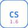

<!-- every image has a dark and a light version; dark sources use absolute raw URLs because GitHub does not document relative srcset -->

<picture>
  <source media="(prefers-color-scheme: dark)" srcset="https://raw.githubusercontent.com/UXinCode/UXinCode/main/assets/header.svg">
  
</picture>

<!-- one box: Discord status (60%) + buttons (8% each); keep the links on one line -->

<a href="https://discord.com/users/423592024395087884"><picture><source media="(prefers-color-scheme: dark)" srcset="https://raw.githubusercontent.com/UXinCode/UXinCode/main/assets/discord-status.svg"></picture></a><a href="https://discord.com/users/423592024395087884"><picture><source media="(prefers-color-scheme: dark)" srcset="https://raw.githubusercontent.com/UXinCode/UXinCode/main/assets/discord.svg"></picture></a><a href="https://cs-wiaderko.com/profile/577-akari/"><picture><source media="(prefers-color-scheme: dark)" srcset="https://raw.githubusercontent.com/UXinCode/UXinCode/main/assets/wiaderko.svg"></picture></a><a href="https://steamcommunity.com/id/aKaRiOfficia"><picture><source media="(prefers-color-scheme: dark)" srcset="https://raw.githubusercontent.com/UXinCode/UXinCode/main/assets/steam.svg"></picture></a><a href="https://amxx.pl/user/89983-akari/"><picture><source media="(prefers-color-scheme: dark)" srcset="https://raw.githubusercontent.com/UXinCode/UXinCode/main/assets/cs16.svg"></picture></a><a href="https://www.youtube.com/@MVGAmator"><picture><source media="(prefers-color-scheme: dark)" srcset="https://raw.githubusercontent.com/UXinCode/UXinCode/main/assets/youtube.svg"></picture></a>

<picture>
  <source media="(prefers-color-scheme: dark)" srcset="https://raw.githubusercontent.com/UXinCode/UXinCode/main/assets/terminal.svg">
  
</picture>

  
  &nbsp;
  
  &nbsp;
  

<picture>
  <source media="(prefers-color-scheme: dark)" srcset="https://raw.githubusercontent.com/UXinCode/UXinCode/snake/snake.svg">
  
</picture>

